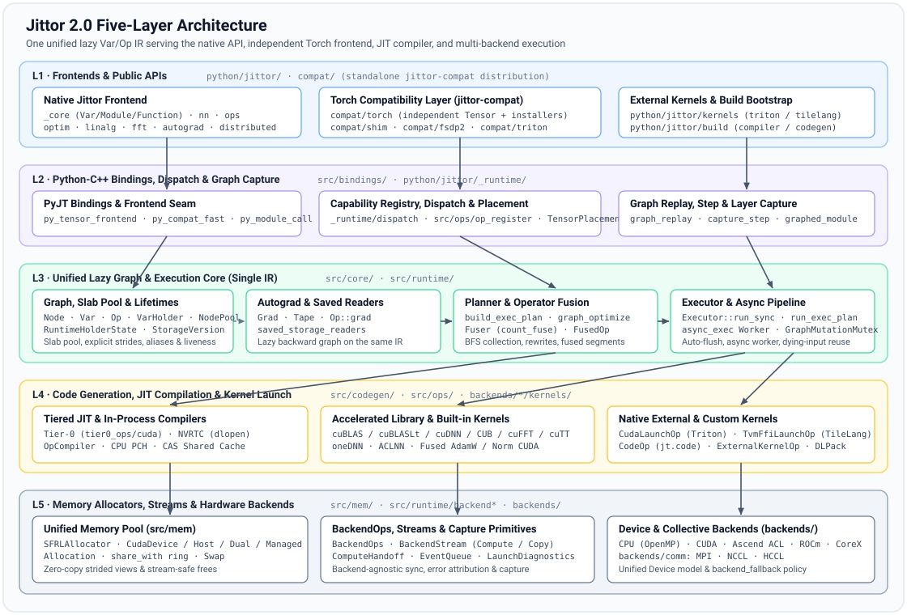
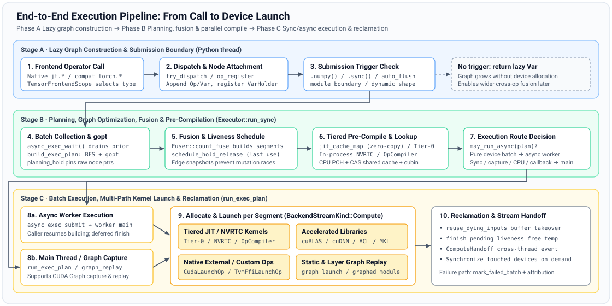
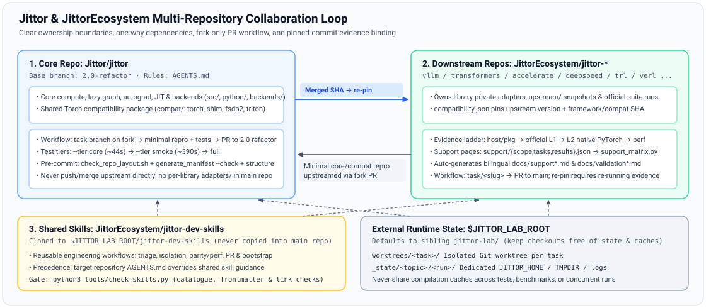

# System architecture and execution overview

[Section contents](index.en.md) · [中文](architecture-overview.md)

This page gives a system-level map of Jittor 2.0: its five-layer architecture, the end-to-end
pipeline from a Python call to device launch, and the three-repository collaboration loop between
`Jittor/jittor` and `JittorEcosystem`. Use [source architecture](source-architecture.en.md) for
Python package ownership and [repository layout](repository-layout.en.md) for packaging and path
invariants.

- Status: Active architecture overview
- Baseline: `2d05459ad` (`2.0-refactor`)
- Owner: Core runtime and architecture maintainers
- Review trigger: Changes to the execution pipeline, JIT compilation path, backend abstraction, or cross-repository workflow

## 1. Five-layer architecture

Jittor 2.0 is built around **one unified lazy computation graph (`Var` / `Op` IR) shared by every
frontend and hardware backend**. Both the native Jittor API and the standalone `jittor-compat`
Torch frontend lower into the same C++ graph, fuser, JIT compilation pipeline, memory allocator,
and stream runtime—there is no second graph and no duplicate math implementation.

| Layer | Source owner | Responsibilities | Detailed contracts |
| --- | --- | --- | --- |
| L1 Frontends & public APIs | `python/jittor/`, `compat/` | Native Python API, independent Torch frontend & shim, external kernel entry points, build bootstrap | [Source architecture](source-architecture.en.md), [Torch architecture](compatibility/torch-architecture.en.md) |
| L2 Bindings, dispatch & capture | `src/bindings/`, `python/jittor/_runtime/` | PyJT bindings, `PyContextVar` frontend seam, capability registry/dispatch, `graph_replay`, `capture_step`, and trainable `jt.graphed_module` | [Operator dispatch](runtime/operator-dispatch.en.md), [Static graph replay](runtime/static-graph-replay.en.md) |
| L3 Lazy graph & execution core | `src/core/`, `src/runtime/` | `Node`/`Var`/`Op`/`VarHolder`/`NodePool` slab pool & `StorageVersion`, autograd, planning & fusion, `async_exec` pipeline | [Native runtime](runtime/native-runtime.en.md), [Storage layout](runtime/storage-layout.en.md) |
| L4 Codegen & kernel launch | `src/codegen/`, `src/ops/`, `backends/*/kernels/` | Tier-0 precompiled meta-ops, in-process CUDA NVRTC, `OpCompiler` + CPU PCH + CAS shared cache, library ops & native `CudaLaunchOp`/`TvmFfiLaunchOp` | [JIT operator source](runtime/jit-operator-source.en.md), [External kernels](../notes/runtime/external-kernels.en.md) |
| L5 Memory, streams & backends | `src/mem/`, `src/runtime/backend*`, `backends/` | `SFRLAllocator`, shared storage rings, swap, `BackendOps`, stream handoff, device & collective backends | [Backend build](backends/backend-build.en.md), [Async error diagnostics](runtime/async-error-diagnostics.en.md) |

## 2. End-to-end execution pipeline

Execution is **lazy by default**: operator construction appends nodes to the graph and returns a
pending `VarHolder`. Only when a readout (`.numpy()`, `.item()`, `.sync()`), dynamic-shape
resolution, module boundary, or `auto_flush_ops` threshold fires does `Executor::run_sync` plan and
execute a batch (see [pipelined execution](../notes/runtime/pipelined-execution.en.md)).

Core runtime invariants:

1. **One-way dependency and single IR**: `compat/` may depend on `jittor`, never the reverse.
   `torch.Tensor` and `jittor.Var` share the same `VarHolder` payload and graph nodes through the
   `PyContextVar` seam in `src/bindings/pyjt/py_tensor_frontend.*`
   (see [frontend boundaries](compatibility/frontend-boundaries.en.md)).
2. **Edge snapshots and batch holds**: `build_exec_plan` collects reachable nodes under
   `graph_mutation_mutex`, retains raw pointers via `planning_hold` / `batch_hold`, and snapshots
   op edges so fusion and the async worker never read live mutating edges concurrently.
3. **Async submission and cross-thread stream handoff**: Pure device batches without synchronous
   Python callbacks may be handed to the worker thread in `src/runtime/async_exec.cc`
   (`may_run_async`), letting the caller continue building the next graph while `ComputeHandoff`
   orders compute-stream work across threads.
4. **Dying-input reuse and scheduled reclamation**: `schedule_hold_release` drops temporary holds
   after each segment's last use, and `reuse_dying_inputs` lets elementwise outputs take over a
   dying input's memory block in place to cut peak memory and memory traffic.
5. **External kernel boundary**: Native C++ launch operators `CudaLaunchOp` (Triton) and
   `TvmFfiLaunchOp` (TileLang), alongside `ExternalKernelOp` and custom `CodeOp`, follow the same
   placement, compute-stream ordering, async-worker, and CUDA Graph capture contracts as built-in
   operators (see [external kernels](../notes/runtime/external-kernels.en.md)).

## 3. Core C++ and backend source map

While [source architecture](source-architecture.en.md) maps `python/jittor/`, the table below maps
the C++ core and backend trees:

| Directory | Key subdirectories / files | Ownership |
| --- | --- | --- |
| `src/core/` | `node.*`, `node_pool.h`, `storage_version.h`, `var.*`, `op.*`, `var_holder.*`, `grad.*`, `exec_plan.*`, `fuser.*`, `fused_op.*`, `executor.*`, `exec_runner.*`, `parallel_compiler.*` | Graph IR, hot leaf slab pool, lock-free storage version, liveness, backward construction, planning, fusion, parallel pre-compile, execution loop |
| `src/runtime/` | `runtime.*`, `holder_state.*`, `async_exec.*`, `tier0_ops.*`, `backend.*`, `backend_streams.*`, `graph_capture.*`, `tensor_placement.*`, `launch_diagnostics.*`, `profiler/` | Process-lifetime runtime owner, async worker, Tier-0 precompiled meta-ops & async promotion, backend ops table, streams/capture, async error diagnostics |
| `src/codegen/` | `jit_compiler.*`, `nvrtc_compiler.*`, `op_compiler.*`, `opt/kernel_ir.*`, `opt/pass/`, `opt/tuner/` | Fused kernel codegen, in-process CUDA NVRTC, IR optimization passes, loop/thread tuners, CPU PCH & CAS shared cache compiler driver |
| `src/ops/` | `op_register.*`, `binary_op.*`, `unary_op.*`, `reduce_op.*`, `reindex_*`, `composite/{cuda_launch_op,tvm_ffi_launch_op,external_kernel_op}.*` | Meta-ops, composite ops, `NativeOpRegistry`, and native external-kernel launch operators |
| `src/mem/` | `allocator.*`, `allocator/sfrl_allocator.*`, `allocator/cuda_*`, `swap.*`, `mem_info.*` | SFRL memory pool, CPU/CUDA/Dual/Managed allocators, and host swap |
| `src/bindings/` | `pyjt/`, `pybind/` | Python/C++ bindings, frontend wrappers, DLPack, and hot-path native calls |
| `src/type/` & `src/utils/` | `nano_string.*`, `nano_vector.*`, `jit_key.*`, `jit_cache_map.h`, `cache_compile.*`, `flags.*` | Compact dtype/shape containers, JIT keys, bounded LRU cache, disk compile cache, runtime flags |
| `backends/` | `cpu/`, `cuda/`, `acl/`, `rocm/`, `corex/`, `comm/{mpi,nccl,hccl}` | Backend build configs, library kernel bindings (cuBLAS/cuDNN/CUB/oneDNN/ACLNN), and collectives |
| `compat/` | `torch/`, `shim/`, `fsdp2/`, `triton/`, `tests/` | Standalone `jittor-compat` distribution, install transactions, and cross-frontend test suites |

## 4. Multi-repository collaboration with JittorEcosystem

Development spans **three repository layers**—the core repo, per-library downstream integration
repos, and the shared skill repo—with all external worktrees, caches, models, and raw logs kept
under `$JITTOR_LAB_ROOT`:

| Repository layer | Ownership boundary | Branch & PR rule | Evidence & synchronization |
| --- | --- | --- | --- |
| Core repo `Jittor/jittor` | Core compute, lazy graph, JIT, backends, and shared `compat/` semantics; **no** per-library `adapters/` or process boards | Branch in personal fork off latest `2.0-refactor`, open PR to `Jittor/jittor:2.0-refactor`; maintainers merge | `core` / `smoke` / `full` tiers + layout, manifest & structure gates |
| Downstream repos `JittorEcosystem/jittor-*` | Library-private adapters, `upstream/` snapshots, official tests/examples, and bilingual support/validation pages | `task/<slug>` branch in repo, open PR to `main`; merge once required checks and evidence pass | `compatibility.json` pins upstream + framework SHA; `support_matrix.py --update` generates support pages |
| Skills repo `JittorEcosystem/jittor-dev-skills` | Reusable cross-repo workflows for triage, isolation, parity/perf, and PRs; cloned to `$JITTOR_LAB_ROOT/jittor-dev-skills` | `task/<slug>` branch in repo, open PR to `main`; validated by `python3 tools/check_skills.py` | Target repo `AGENTS.md` overrides shared skills; tools live in each code repo |

Issue triage follows three rules (see [compatibility principles](compatibility/principles.en.md) and
[downstream scorecards](testing/downstream-scorecards.en.md)):

1. **Missing compute capability or wrong numerical result** → fix in core/backend with a minimal
   regression that does not depend on downstream models.
2. **Public Torch signature, object identity, or shared semantic mismatch** → fix in `compat/` with
   public API behavior or structure regression tests.
3. **Downstream-private API, plugin registration, entry point, or version quirk** → fix and verify
   in the corresponding `JittorEcosystem/jittor-*` repository.

When downstream work requires a framework fix, follow the closed loop: **core fork PR → merged
framework commit SHA → update `compatibility.json` pin in downstream repo → re-run affected
evidence and regenerate bilingual support pages**. Never retain stale "verified" statuses across a
pin change.

## Next reading

- Python package ownership: [Source architecture and module boundaries](source-architecture.en.md)
- Packaging and hard path invariants: [Repository layout](repository-layout.en.md)
- Test tiers and execution commands: [Choose and run tests](testing/test-system.en.md)
