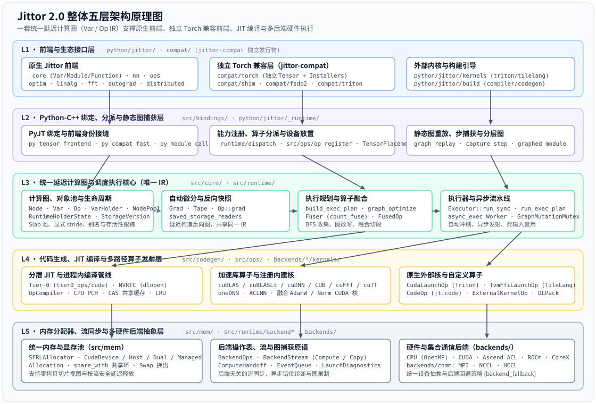
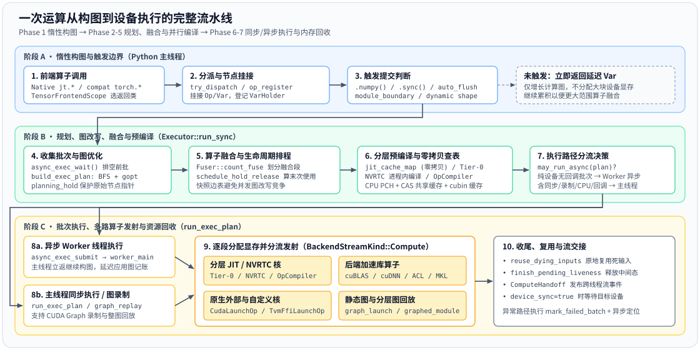
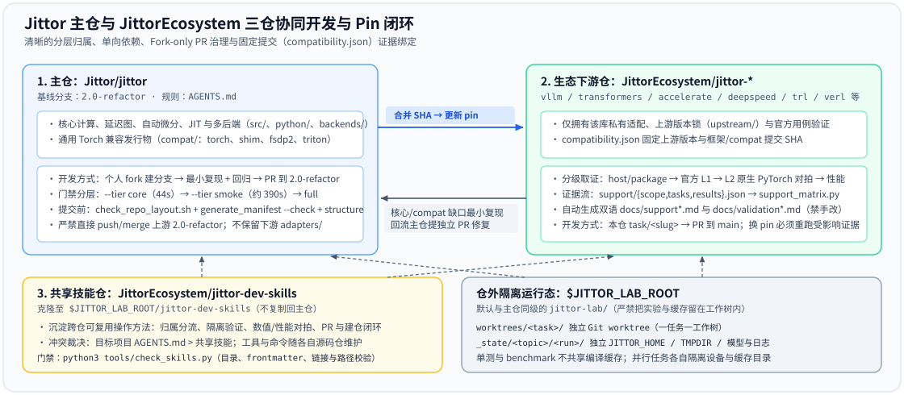

# 整体架构与运行原理

[本栏目目录](index.md) · [English](architecture-overview.en.md)

本页从系统视角展示 Jittor 2.0 的五层分层结构、一次运算从 Python 调用到设备发射的完整流水线，
以及主仓 `Jittor/jittor` 与 `JittorEcosystem` 多仓协同开发的边界闭环。需要查找具体 Python 包归属时看
[源码架构与模块边界](source-architecture.md)，需要核对打包与路径约束时看[仓库布局](repository-layout.md)。

- 状态：现行架构总览
- 基线：`2d05459ad`（`2.0-refactor`）
- 维护者：核心运行时与架构维护者
- 复查触发：核心执行管线、JIT 编译路径、后端抽象或跨仓协作协议发生变化

## 1. 五层整体架构

Jittor 2.0 的核心设计原则是**一套统一延迟计算图（`Var` / `Op` IR），多个前端与多硬件后端共享**：
原生 Jittor API 与独立发行物 `jittor-compat` 的 Torch 兼容前端共同落到同一套 C++ 计算图、融合器、
JIT 编译管线与内存/流运行时，不维护第二张图，也不复制第二份数学实现。

| 层次 | 源码归属 | 核心职责 | 详细契约 |
| --- | --- | --- | --- |
| L1 前端与生态接口 | `python/jittor/`、`compat/` | 原生 Python API、独立 Torch 前端与 shim、外部核入口与构建引导 | [源码架构](source-architecture.md)、[Torch 分层架构](compatibility/torch-architecture.md) |
| L2 绑定、分派与捕获 | `src/bindings/`、`python/jittor/_runtime/` | PyJT 绑定、`PyContextVar` 前端身份接缝、能力注册/分派、静态图回放、`capture_step` 与可训练分层图 `jt.graphed_module` | [算子分派](runtime/operator-dispatch.md)、[静态图回放](runtime/static-graph-replay.md) |
| L3 延迟图与执行核心 | `src/core/`、`src/runtime/` | `Node`/`Var`/`Op`/`VarHolder`/`NodePool` Slab 池与 `StorageVersion`、自动微分、执行规划与融合、`async_exec` 流水线 | [原生运行时](runtime/native-runtime.md)、[存储与别名](runtime/storage-layout.md) |
| L4 代码生成与算子发射 | `src/codegen/`、`src/ops/`、`backends/*/kernels/` | Tier-0 预编译元算子、进程内 CUDA NVRTC、`OpCompiler` + CPU PCH + CAS 共享缓存、加速库与原生 `CudaLaunchOp`/`TvmFfiLaunchOp` | [JIT 算子源码](runtime/jit-operator-source.md)、[外部内核](../notes/runtime/external-kernels.md) |
| L5 内存、流与后端抽象 | `src/mem/`、`src/runtime/backend*`、`backends/` | `SFRLAllocator` 显存池、共享存储环、换出、后端操作表、流/事件同步与多硬件/通信后端 | [后端构建](backends/backend-build.md)、[异步错误诊断](runtime/async-error-diagnostics.md) |

## 2. 一次运算的构图与执行流水线

Python 侧默认执行**惰性构图**：算子构造先挂载节点到图上并返回延迟的 `VarHolder`，直到遇到显式读取
（`.numpy()` / `.item()` / `.sync()`）、动态形状求解、模块边界或 `auto_flush_ops` 阈值时，才由
`Executor::run_sync` 组织一次批次执行（详见[流水式惰性执行](../notes/runtime/pipelined-execution.md)）。

关键运行不变量如下：

1. **单向依赖与唯一 IR**：`compat/` 只能依赖 `jittor`，反向禁止；`torch.Tensor` 与 `jittor.Var`
   经由 `src/bindings/pyjt/py_tensor_frontend.*` 的 `PyContextVar` 接缝共享同一份 `VarHolder` 与图节点
   （见[前端边界](compatibility/frontend-boundaries.md)）。
2. **边快照与生命周期持有**：`build_exec_plan` 在 `graph_mutation_mutex` 保护下收集可达节点，用
   `planning_hold` / `batch_hold` 固定原始指针并对边表做只读快照，确保融合器与异步 worker 不会读到并发修改中的活边。
3. **异步发射与跨线程流交接**：对纯设备、无同步 Python 回调的批次，`may_run_async` 允许交由
   `src/runtime/async_exec.cc` 的 worker 线程执行，主线程立即继续构图；跨线程共享同一设备计算流时通过
   `ComputeHandoff` 事件严格保序。
4. **原地复用与显式释放**：执行器基于末次使用排程（`schedule_hold_release`）在段末释放临时持有，并通过
   `reuse_dying_inputs` 让逐元素输出直接接管即将释放的输入显存块，降低训练峰值显存与带宽流量。
5. **外部内核边界**：原生 C++ 发射算子 `CudaLaunchOp`（Triton）、`TvmFfiLaunchOp`（TileLang）以及
   `ExternalKernelOp`、`CodeOp` 遵守与内建算子相同的设备放置、流序、异步工作线程与 CUDA Graph 捕获约定
   （见[外部内核](../notes/runtime/external-kernels.md)）。

## 3. 核心源码目录地图

`source-architecture.md` 给出了 `python/jittor/` 的包划分；下表补齐 C++ 核心与硬件后端目录，便于跨层定位：

| 目录 | 关键子目录与文件 | 负责内容 |
| --- | --- | --- |
| `src/core/` | `node.*`、`node_pool.h`、`storage_version.h`、`var.*`、`op.*`、`var_holder.*`、`grad.*`、`exec_plan.*`、`fuser.*`、`fused_op.*`、`executor.*`、`exec_runner.*`、`parallel_compiler.*` | 图数据结构、高频叶子 Slab 池、无锁存储版本、存活性、反向构图、规划、融合、并行预编译与执行主循环 |
| `src/runtime/` | `runtime.*`、`holder_state.*`、`async_exec.*`、`tier0_ops.*`、`backend.*`、`backend_streams.*`、`graph_capture.*`、`tensor_placement.*`、`launch_diagnostics.*`、`profiler/` | 进程级运行时 owner、异步 worker、Tier-0 预编译元算子与异步晋升、后端操作表、流/事件/图捕获与异步错误归因 |
| `src/codegen/` | `jit_compiler.*`、`nvrtc_compiler.*`、`op_compiler.*`、`opt/kernel_ir.*`、`opt/pass/`、`opt/tuner/` | 融合源码生成、进程内 CUDA NVRTC、IR 优化 Pass、循环/线程调优器、CPU PCH 与 CAS 共享缓存编译驱动 |
| `src/ops/` | `op_register.*`、`binary_op.*`、`unary_op.*`、`reduce_op.*`、`reindex_*`、`composite/{cuda_launch_op,tvm_ffi_launch_op,external_kernel_op}.*` | 元算子与组合算子实现、全局算子注册表（`NativeOpRegistry`）及原生外部核发射算子 |
| `src/mem/` | `allocator.*`、`allocator/sfrl_allocator.*`、`allocator/cuda_*`、`swap.*`、`mem_info.*` | 统一内存/显存池（SFRL）、CPU/CUDA/Dual/Managed 分配器与显存换出 |
| `src/bindings/` | `pyjt/`、`pybind/` | Python/C++ 绑定代码、前端对象包装、DLPack 与热路径快速调用入口 |
| `src/type/` & `src/utils/` | `nano_string.*`、`nano_vector.*`、`jit_key.*`、`jit_cache_map.h`、`cache_compile.*`、`flags.*` | dtype/shape 紧凑表示、JIT 缓存键与有界 LRU 缓存、磁盘编译缓存与 flag 基础设施 |
| `backends/` | `cpu/`、`cuda/`、`acl/`、`rocm/`、`corex/`、`comm/{mpi,nccl,hccl}` | 各硬件后端构建配置、库算子绑定（cuBLAS/cuDNN/CUB/oneDNN/ACLNN 等）与集合通信 |
| `compat/` | `torch/`、`shim/`、`fsdp2/`、`triton/`、`tests/` | 独立发行的 `jittor-compat` 兼容前端、安装事务与跨前端测试 |

## 4. 与 JittorEcosystem 的三仓协同架构

Jittor 采用**主仓核心 + 独立下游生态仓 + 共享开发技能仓**的三层仓库协同模式，并用仓外 `$JITTOR_LAB_ROOT`
隔离 worktree、编译缓存、模型与原始日志：

| 仓库层 | 职责边界 | 开发与合入规则 | 证据与同步机制 |
| --- | --- | --- | --- |
| 主仓 `Jittor/jittor` | 核心计算、延迟图、JIT、后端及通用 `compat/` 语义；**不保存**逐库 `adapters/` 或过程看板 | 从个人 fork 基于最新 `2.0-refactor` 建分支，向 `Jittor/jittor:2.0-refactor` 提 PR；维护者合并 | `core` / `smoke` / `full` 单测分层 + 布局/清单/结构门禁 |
| 生态下游仓 `JittorEcosystem/jittor-*` | 仅拥有该库私有适配、`upstream/` 版本快照、官方用例与双语支持/验证页 | 本仓 `task/<slug>` 分支向 `main` 提 PR；必需检查与证据齐全后合并 | `compatibility.json` 固定上游与框架 SHA；`support_matrix.py --update` 生成支持/验证页 |
| 技能仓 `JittorEcosystem/jittor-dev-skills` | 跨仓可复用的排查、验证、对拍与协作技能；本地克隆至 `$JITTOR_LAB_ROOT/jittor-dev-skills` | 本仓 `task/<slug>` 分支向 `main` 提 PR；`python3 tools/check_skills.py` 校验 | 目标仓 `AGENTS.md` 优先于共享技能；工具与命令随各自源码仓维护 |

问题归属遵循三行分流判据（详见[兼容原则](compatibility/principles.md)与[下游验证协议](testing/downstream-scorecards.md)）：

1. **计算能力缺失或数值错误** → 在主仓核心与后端修复，补不依赖下游大模型的最小回归；
2. **公共 Torch 签名、对象身份或共享语义不兼容** → 在主仓 `compat/` 修复并补公共 API 行为/结构回归；
3. **下游库私有 API、插件注册、入口或版本差异** → 在对应 `JittorEcosystem/jittor-*` 仓库修复并验证。

当一次下游任务触发主仓修复时，必须按**主仓 fork PR → 合并拿到框架提交 SHA → 下游更新 `compatibility.json` pin → 重跑受影响证据并重新生成双语支持页**的闭环推进，严禁将未绑定当前 pin 的旧运行结果保留为已验证状态。

## 下一步阅读

- 定位 Python 模块归属：[源码架构与模块边界](source-architecture.md)
- 理解构建、打包与硬路径不变量：[仓库布局](repository-layout.md)
- 选择合适的单测分层与命令：[选择并运行测试](testing/test-system.md)
